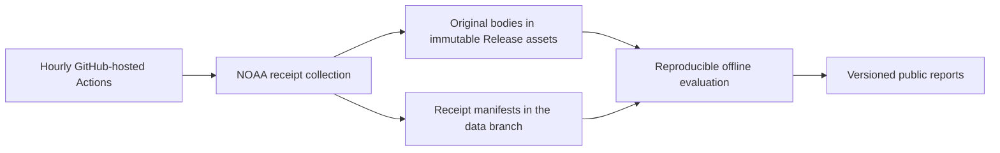

# NOAA water-level research

Public, reproducible evaluation of original NOAA ETSS water-level forecasts against observed water levels and fixed tide-based comparison methods.

The project asks whether those forecasts improve accuracy at Friday Harbor, Port Townsend and Seattle, including rapid water-level changes. Failed and inconclusive results are research outcomes too.

**Status — October 21, 2026:** repository and migration plan created. Hosted collection, data import and evaluation workflows are not deployed yet. The existing local collector remains active until a verified handoff.

[Read the design, implementation plan and acceptance checks](https://github.com/openwatersio/noaa-water-level-research/issues/1).

## Planned operation

- `main`: reviewed code, tests, provider contracts, frozen protocols and input pins.
- `data`: original receipt manifests and indexes into Release assets.
- `reports`: versioned results, acquisition coverage and health summaries.
- Releases: original response bodies, preserved errors and incomplete captures, and large derived report bundles.

Only `main` exists at this planning stage. Raw response bodies will not be committed to the code branch. A future archive download-and-verify command will reconstruct a pinned dataset; cloning the repository alone will not download the Release assets.

Collection and analysis will run on standard GitHub-hosted runners without a Mac Studio or Codex session. Scheduled Actions can be delayed or dropped, so coverage reports will record gaps and actual receipt times rather than claiming uninterrupted acquisition. A separate audit workflow will report stale or failed collection, subject to the same GitHub availability limits.

## Evaluation calendar

The existing [frozen prospective protocol](https://github.com/openwatersio/slackwater/issues/402) governs the migration:

| Phase | Dates |
| --- | --- |
| Development checks | Before November 1, 2026 |
| Calibration decisions | November 1–30, 2026 |
| Freeze calibrated widths | After December 3 at 13:00 UTC and before December 4 at 02:00 UTC |
| Independent confirmation decisions | December 4, 2026–January 31, 2027 |
| Fully mature final evaluation | Early February 2027 |

All receipts, revisions and failures remain distinguishable. Reports must identify the exact code, data snapshot, protocol and truth vintage. Insufficient rapid-event samples produce an inconclusive result; publication of a parser or report does not establish production forecast acceptance.

## Relationship to Slackwater

This repository will own the research collection and evaluation currently proposed in Slackwater PRs #408–#411. Reusable engine math in [PR #407](https://github.com/openwatersio/slackwater/pull/407), production APIs and application integration remain in Slackwater. Research code, attribution and licensing will be migrated through reviewed pull requests.

The existing collector will remain active through at least 48 hours of hosted overlap, a verified legacy import, and a published source boundary. The final local receipts will be imported before the handoff is declared complete.
Reproducible prospective evaluation of NOAA water-level forecasts, with original receipts and explicit accuracy criteria.
